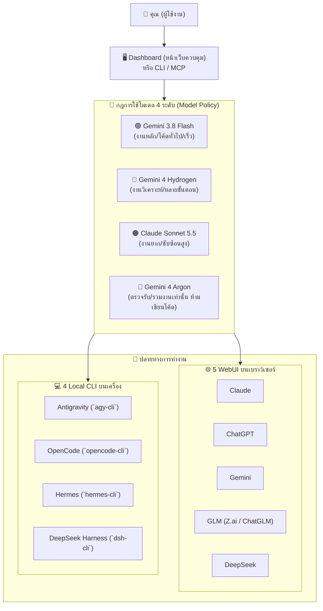

# คู่มือการใช้งานแบบจับมือทำสำหรับมือใหม่ (Beginner Step-by-Step Guide)
**ระบบ WebUI Control AI: Open Multi-Engine Autonomous Orchestra**

ยินดีต้อนรับสู่ระบบ **WebUI Control AI** ซึ่งเป็นแพลตฟอร์มประสานงาน AI หลายค่ายที่ช่วยให้คุณเชื่อมต่อพลังของ **5 เว็บแชต AI (WebUI)** และ **4 โปรแกรมสั่งงานเขียนโค้ดบนเครื่อง (Local CLI)** เข้าด้วยกันอย่างเป็นระบบ ปลอดภัย และไร้ความซับซ้อน!

เอกสารฉบับนี้ออกแบบมาสำหรับผู้ใช้งานเริ่มต้นโดยเฉพาะ ทุกขั้นตอนสามารถทำตามได้ทันที ไม่จำเป็นต้องมีความรู้สถาปัตยกรรมระดับลึก

---

## สารบัญ (Table of Contents)
1. [ภาพรวมเข้าใจง่ายใน 1 นาที (What is What?)](#1-ภาพรวมเข้าใจง่ายใน-1-นาที-what-is-what)
   - [กฎการใช้โมเดล 4 ระดับ (Model Role Policy)](#กฎการใช้โมเดล-4-ระดับ-model-role-policy)
   - [5 WebUI ที่ส่งงานไปได้](#5-webui-ที่ส่งงานไปได้-browser-based-ai)
   - [4 โปรแกรม CLI บนเครื่องที่สั่งรันงานได้](#4-โปรแกรม-cli-บนเครื่องที่สั่งรันงานได้-local-cli-harnesses)
2. [วิธีติดตั้งแบบกึ่งอัตโนมัติ (Semi-Automated Setup — ดับเบิลคลิก 1 ไฟล์!)](#2-วิธีติดตั้งแบบกึ่งอัตโนมัติ-semi-automated-setup)
3. [วิธีเปิดใช้งานครั้งแรก (เลือก 1 ใน 3 วิธีตามความถนัด)](#3-วิธีเปิดใช้งานครั้งแรก-เลือก-1-ใน-3-วิธี)
   - [วิธีที่ A: ง่ายที่สุด — ผ่านหน้าเว็บ Dashboard](#วิธีที่-a-ง่ายที่สุด--ผ่านหน้าเว็บ-dashboard)
   - [วิธีที่ B: สั่งผ่านคำสั่งลัด CLI ทีละขั้น](#วิธีที่-b-สั่งผ่านคำสั่งลัด-cli-ทีละขั้น)
   - [วิธีที่ C: ให้ใครก็ได้เป็นหัวหน้าวง (Orchestrator ผ่าน MCP)](#วิธีที่-c-ให้ใครก็ได้เป็นหัวหน้าวง-anyone-as-orchestrator-ผ่าน-mcp)
4. [ตารางแก้ปัญหาที่พบบ่อยสำหรับมือใหม่ (Troubleshooting FAQ)](#4-ตารางแก้ปัญหาที่พบบ่อยสำหรับมือใหม่-troubleshooting-faq)

---

## 1. ภาพรวมเข้าใจง่ายใน 1 นาที (What is What?)

ระบบนี้สร้างขึ้นเพื่อให้คุณมี "วงดนตรี AI" ทำงานร่วมกันได้อย่างลงตัว ไม่ต้องคัดลอกโค้ดไปมาด้วยความสับสนอีกต่อไป



### กฎการใช้โมเดล 4 ระดับ (Model Role Policy)

ระบบกำหนดบทบาทของโมเดลไว้อย่างชัดเจน เพื่อความคุ้มค่า ประสิทธิภาพ และป้องกันความผิดพลาด:

| ระดับโมเดล | ชื่อโมเดล | บทบาทและหน้าที่ (Role & Scope) | จุดเด่น |
|---|---|---|---|
| 🟢 **ระดับ 1** | **Gemini 3.8 Flash** | **โมเดลคนทำงานหลัก (Default Worker)**: สำหรับงานทั่วไป เขียนโค้ด Unit Test สรุปงาน และรันคำสั่ง | ความเร็วสูงมาก ประหยัดโควตา และตอบสนองทันใจ |
| 🔵 **ระดับ 2** | **Gemini 4 Hydrogen** | **โมเดลเสริมพลัง (Advanced Worker)**: สำหรับงานคิดวิเคราะห์ ตรรกะหลายขั้นตอน สถาปัตยกรรมระดับกลาง และงานแก้บักซับซ้อน | ความสามารถในการใช้เหตุผลสูง ตรวจจับจุดบกพร่องได้แม่นยำ |
| 🟠 **ระดับ 3** | **Claude Sonnet 5.5** | **โมเดลงานยากพิเศษ (Hard Tasks Only)**: สำรองไว้เฉพาะงานที่ยากมาก โครงสร้างระบบหลัก และข้อกำหนดความปลอดภัยสูง | ความลึกซึ้งในการเขียนสถาปัตยกรรมและความรอบคอบสูงสุด |
| 🔴 **ระดับ 4** | **Gemini 4 Argon** | **โมเดลผู้ตรวจการ (Review & Merge Only)**: **ห้ามใช้ทำงานเขียนโค้ดเองเด็ดขาด!** ทำหน้าที่ตรวจรับงาน (Reviewer) และรวมผลลัพธ์ (Merge Gate) เท่านั้น | เป็นกลาง เข้มงวด และตรวจสอบความถูกต้องตามเกณฑ์ QA |

> [!IMPORTANT]
> **กฎเหล็กของ Gemini 4 Argon**: หากคุณพยายามเลือก Gemini 4 Argon ไปใช้เขียนโค้ดหรือสั่ง Worker ทั่วไป ระบบจะมีระบบป้องกันความปลอดภัย (`Policy block`) ปฏิเสธการรันโดยอัตโนมัติ เพื่อรักษาความเป็นกลางในการตรวจงาน!

---

### 5 WebUI ที่ส่งงานไปได้ (Browser-Based AI)
1. **Claude (`claude.ai`)**: เก่งงานออกแบบโครงสร้าง ออกแบบสัญญางาน และเขียนโค้ดที่ต้องการความถูกต้องสูง
2. **ChatGPT (`chatgpt.com`)**: เก่งการระดมไอเดีย เขียนเอกสาร และสร้างกรณีทดสอบ (Test Cases)
3. **Gemini (`gemini.google.com`)**: จุดเด่นคือรับบริบทขนาดใหญ่มาก (Mega Context) อ่านไฟล์หลายไฟล์พร้อมกัน
4. **GLM (`chat.z.ai` หรือ `chatglm.cn`)**: ทางเลือกสำหรับการเปรียบเทียบคำตอบและการวิเคราะห์เฉพาะทาง
5. **DeepSeek (`chat.deepseek.com`)**: โมเดลการคิดวิเคราะห์ลึก (Deep Thinking) เหมาะกับการแก้บั๊กยากๆ

### 4 โปรแกรม CLI บนเครื่องที่สั่งรันงานได้ (Local CLI Harnesses)
1. **Antigravity CLI (`bin\agy-cli.cmd`)**: AI Agent ผู้ช่วยหลักพร้อมโปรโตคอล MCP
2. **OpenCode CLI (`bin\opencode-cli.cmd`)**: Agent เขียนโค้ดรวดเร็ว รองรับการสั่งงานแบบ Standalone ใน Sandbox
3. **Hermes CLI (`bin\hermes-cli.cmd`)**: สั่งการ AI บนเครื่องพร้อมเลือกระบบโปรไฟล์ (`default`, `fast`, `research`, `reviewer`)
4. **DeepSeek Harness CLI (`bin\dsh-cli.cmd`)**: ขุมพลัง DeepSeek ในรูปแบบคำสั่ง Headless สั่งรันใน Terminal ได้ทันที

---

## 2. วิธีติดตั้งแบบกึ่งอัตโนมัติ (Semi-Automated Setup)

คุณไม่จำเป็นต้องพิมพ์คำสั่งยาวๆ หรือตั้งค่าฐานข้อมูลเองให้ยุ่งยาก ระบบมีตัวติดตั้งกึ่งอัตโนมัติที่ทำงานจบในไฟล์เดียว:

### ขั้นตอนการติดตั้งง่ายๆ:
1. เปิดโฟลเดอร์โครงการ `WebUI_Control_AI`
2. **ดับเบิลคลิกที่ไฟล์:**
   ```
   INSTALL_SETUP.cmd
   ```
   *(หรือเปิด Terminal / PowerShell แล้วพิมพ์ `.\INSTALL_SETUP.cmd`)*

ตัวติดตั้งจะเปิดหน้าต่างขึ้นมา และนำทางคุณผ่าน 5 ขั้นตอนอัตโนมัติ:

```
======================================================================
  WebUI Control AI: Semi-Automated Setup Wizard
======================================================================
```

### สิ่งที่ตัวติดตั้งทำให้คุณอัตโนมัติ 5 ขั้นตอน:
1. **ขั้นตอนที่ 1: ตรวจสอบความพร้อมเครื่องมือ (Preflight Doctor)**
   - ตรวจสอบ Python 3.14, Node.js, Bun, Git, 4 โปรแกรม CLI และ 5 WebUI
   - ยืนยันว่าโฟลเดอร์ต้องห้าม (`REA Project`) และพอร์ต Serena (`9121`) ได้รับการปกป้องอย่างปลอดภัย
2. **ขั้นตอนที่ 2: สร้างฐานข้อมูลและโครงสร้างรันไทม์ (Runtime & Database)**
   - สร้างโฟลเดอร์ `.runtime/state/`, `.runtime/sandboxes/`, `.runtime/webui_packets/`, `.runtime/evidence/`, `.runtime/mcp_configs/`
   - สร้างฐานข้อมูล SQLite พร้อมเปิดโหมดความเร็วสูง Write-Ahead Logging (WAL)
3. **ขั้นตอนที่ 3: สร้างไฟล์ตั้งค่า WebUI (Browser Targets Config)**
   - คัดลอก `config/browser_targets.example.json` ไปยัง `config/browser_targets.json` ให้อัตโนมัติ (ไม่เขียนทับหากคุณมีไฟล์เดิมอยู่แล้ว)
4. **ขั้นตอนที่ 4: สร้างไฟล์เชื่อมต่อ MCP สำหรับโปรแกรมต่างๆ (MCP Configurations)**
   - สร้างไฟล์ตั้งค่าพร้อมใช้งานใน `.runtime/mcp_configs/`:
     - `antigravity_mcp.json` (สำหรับ Antigravity IDE)
     - `opencode_mcp.json` (สำหรับ OpenCode Desktop)
     - `hermes_mcp.json` (สำหรับ Hermes Agent)
     - `claude_desktop_mcp.json` (สำหรับ Claude Desktop)
5. **ขั้นตอนที่ 5: ทดสอบความพร้อมขั้นสุดท้าย (Self-Test Validation)**
   - รันการทดสอบอ่าน/เขียนฐานข้อมูล และทดสอบรันคำสั่ง `--version` ของ CLI ทั้ง 4 ตัว พร้อมแสดงตารางสรุปผลลัพธ์สีเขียว `[OK]` ทุกรายการ!

> [!TIP]
> ในแต่ละขั้นตอน หากคุณต้องการให้ดำเนินการต่อ ให้กดปุ่ม **Enter** (หรือพิมพ์ `Y` แล้วกด Enter)  
> หากต้องการรันแบบรวดเร็วผ่านคำสั่งโดยไม่ต้องกดยืนยัน สามารถสั่ง: `INSTALL_SETUP.cmd --yes`

---

## 3. วิธีเปิดใช้งานครั้งแรก (เลือก 1 ใน 3 วิธี)

เมื่อติดตั้งเสร็จแล้ว คุณสามารถเลือกสั่งงานได้ 3 รูปแบบตามความสะดวก:

---

### วิธีที่ A: ง่ายที่สุด — ผ่านหน้าเว็บ Dashboard

เหมาะสำหรับผู้ใช้ที่ชอบคลิกเมาส์และเห็นหน้าจอสวยงาม:

1. **ดับเบิลคลิกไฟล์:**
   ```
   START_DASHBOARD.cmd
   ```
2. เบราว์เซอร์ของคุณจะเปิดหน้าเว็บ `http://127.0.0.1:8765` ขึ้นมาให้อัตโนมัติ!
3. **การใช้งานบน Dashboard:**
   - **เลือกเป้าหมาย (Target)**: เลือกว่าจะส่งงานให้ WebUI ใด (`Claude`, `ChatGPT`, `Gemini`, `GLM`, `DeepSeek`) หรือ CLI ใด (`Antigravity`, `OpenCode`, `Hermes`, `DSH`)
   - **เลือกระดับโมเดล (Model Tier)**:
     - `🟢 Gemini 3.8 Flash [Default Worker]` — สำหรับงานทั่วไป
     - `🔵 Gemini 4 Hydrogen [Worker]` — สำหรับงานคิดวิเคราะห์หลายขั้นตอน
     - `🟠 Claude Sonnet 5.5 [Hard Tasks Only]` — สำหรับงานยากระดับสูง
     - *(หมายเหตุ: หากเลือก `🔴 Gemini 4 Argon` ระบบจะอนุญาตเฉพาะโหมด Review เท่านั้น)*
   - **พิมพ์เป้าหมายงาน (Goal)**: เช่น *"ช่วยเขียนฟังก์ชันคำนวณภาษีใน Python"*
   - **รับส่งข้อมูล**:
     - กดปุ่ม **Copy Prompt** เพื่อคัดลอกข้อความงานที่ระบบจัดระเบียบให้ นำไปวางในแชตของ WebUI นั้นๆ
     - เมื่อ AI ตอบกลับมา ให้คัดลอกคำตอบมาวางในช่อง **Submit Response** แล้วกดส่งกลับเข้าระบบ
     - *(หากเปิดใช้งานโหมด Auto-CDP ระบบจะเปิดเบราว์เซอร์และส่งข้อความให้โดยอัตโนมัติ)*

---

### วิธีที่ B: สั่งผ่านคำสั่งลัด CLI ทีละขั้น

เหมาะสำหรับผู้ใช้ที่คุ้นเคยกับ Command Prompt หรือ PowerShell:

1. **ตรวจสอบความพร้อมของระบบทั้งหมด:**
   ```cmd
   .\bin\orchestra.cmd doctor
   ```
2. **ส่งงานให้ WebUI สร้างข้อความพร้อมใช้งาน (เช่น DeepSeek หรือ GLM):**
   ```cmd
   .\bin\orchestra.cmd webui-dispatch --provider deepseek --job MY-JOB-01 --goal "ช่วยออกแบบโครงสร้างฐานข้อมูล"
   ```
   ระบบจะสร้างไฟล์และข้อความ Prompt บรรจุสัญญาการทำงานที่ปลอดภัยให้ทันที!

3. **สั่ง DeepSeek Harness (DSH) บนเครื่องทำงานแบบ Headless CLI:**
   ```cmd
   .\bin\dsh-cli.cmd --profile headless --json "สรุปรายการไฟล์ในโปรเจกต์นี้"
   ```

4. **สั่ง OpenCode หรือ Hermes ทำงานใน Sandbox ชั่วคราว:**
   ```cmd
   .\bin\opencode-cli.cmd --prompt "เขียน Unit Test สำหรับฟังก์ชันบวกเลข" --standalone .runtime\sandboxes\TEST_JOB
   ```

---

### วิธีที่ C: ให้ใครก็ได้เป็นหัวหน้าวง (Anyone-as-Orchestrator ผ่าน MCP)

หากคุณใช้งาน **Antigravity IDE**, **OpenCode**, หรือ **Claude Desktop** อยู่แล้ว และต้องการให้โปรแกรมเหล่านั้นทำหน้าที่เป็น "หัวหน้าวง" คอยสั่ง Orchestra อัตโนมัติ:

1. เปิดดูโฟลเดอร์การตั้งค่าที่ตัวติดตั้งสร้างไว้ให้:
   ```
   .runtime\mcp_configs\
   ```
2. นำข้อความในไฟล์ JSON ไปวางในการตั้งค่า MCP ของโปรแกรมของคุณ:
   - สำหรับ **Antigravity IDE**: เปิดไฟล์ `.runtime/mcp_configs/antigravity_mcp.json` แล้วเพิ่มใน `mcpServers`
   - สำหรับ **OpenCode Desktop**: เปิดไฟล์ `.runtime/mcp_configs/opencode_mcp.json` แล้วเพิ่มในการตั้งค่า Agent MCP
   - สำหรับ **Claude Desktop**: คัดลอกเนื้อหาจาก `claude_desktop_mcp.json` ไปใส่ใน `%APPDATA%\Claude\claude_desktop_config.json`
3. ตอนนี้ AI ในโปรแกรมที่คุณใช้ จะมองเห็นเครื่องมือควบคุมของ Orchestra เช่น:
   - `orchestra_doctor`: ตรวจสอบสถานะระบบ
   - `orchestra_list_jobs`: ดูรายการงานทั้งหมด
   - `orchestra_submit_contract`: สั่งรันงานตามสัญญา
   - `orchestra_create_webui_packet`: สั่งสร้างข้อความส่งต่อไปยัง 5 WebUI

---

## 4. ตารางแก้ปัญหาที่พบบ่อยสำหรับมือใหม่ (Troubleshooting FAQ)

| ปัญหาที่อาจพบ | สาเหตุ | วิธีแก้ไขที่ถูกต้อง |
|---|---|---|
| **ดับเบิลคลิก `INSTALL_SETUP.cmd` แล้วหน้าต่างปิดทันที** | สภาพแวดล้อม Windows ไม่อนุญาต หรือรันจากโฟลเดอร์ที่ไม่ถูกต้อง | ให้เปิด PowerShell หรือ Command Prompt เข้าไปที่โฟลเดอร์ `WebUI_Control_AI` แล้วพิมพ์ `.\INSTALL_SETUP.cmd` เพื่อดูข้อความเตือน |
| **ระบบแจ้งเตือน `Policy block: Gemini 4 Argon is reserved for Review and Merge only`** | มีการพยายามนำโมเดล `Gemini 4 Argon` ไปสั่งงานเขียนโค้ดทั่วไป | เปลี่ยนการเลือกโมเดลเป็น `Gemini 3.8 Flash` (สำหรับงานทั่วไป) หรือ `Gemini 4 Hydrogen` (สำหรับงานวิเคราะห์) |
| **รัน `bin\orchestra.cmd doctor` แล้วขึ้น `[FAIL]` ที่ Python** | เครื่องไม่ได้ใช้ Python 3.14 หรือไม่ได้ตั้งค่า PATH | ติดตั้ง Python 3.14.3 ขึ้นไป และตรวจสอบว่าคำสั่ง `python --version` ใน Terminal ให้ผลลัพธ์ 3.14+ |
| **เปิด Dashboard แล้วเบราว์เซอร์ไม่เด้งขึ้นมา** | พอร์ต 8765 อาจถูกใช้งาน หรือคำสั่งเปิดเบราว์เซอร์ของระบบถูกบล็อก | เปิดเบราว์เซอร์ด้วยตนเองแล้วพิมพ์ไปที่ URL: `http://127.0.0.1:8765` หากพอร์ตติดขัด สามารถเปลี่ยนพอร์ตได้ด้วย: `python -m src.webui.dashboard_server --port 8766` |
| **DeepSeek Harness (`dsh-cli.cmd`) รันไม่ติด** | ไม่พบไฟล์ `DeepSeek Harness.exe` ในเครื่อง | ตรวจสอบตำแหน่งติดตั้งโปรแกรม หรือตั้งค่าตัวแปร `DSH_HOME` / แก้ไขพาธใน `config/harnesses.json` |
| **กังวลว่าระบบจะไปกระทบนอกโฟลเดอร์หรือพอร์ตสงวน** | ระบบมีความปลอดภัยในตัวหรือไม่? | **สบายใจได้ 100%!** ระบบมีเกราะป้องกัน `PathGuard` หากมีคำสั่งใดพยายามออกนอก Working Directory หรือแตะต้องโฟลเดอร์/พอร์ตที่ปกป้องไว้ ระบบจะบล็อกและหยุดทำงานทันที |

---

*เอกสารคู่มือฉบับนี้จัดทำโดยทีมพัฒนา เพื่อให้ผู้ใช้ทุกคนสามารถควบคุมพลังของ Multi-Engine AI ได้อย่างมั่นใจและปลอดภัย*