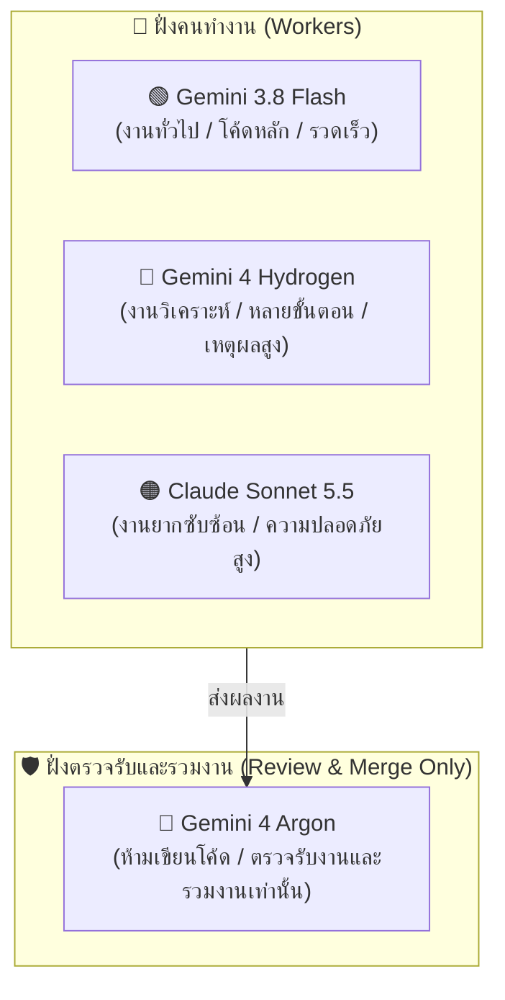
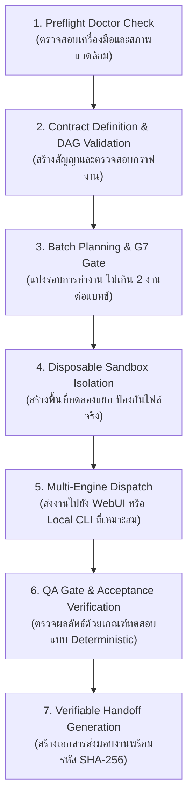

# คู่มือการใช้งานระบบควบคุมและประสานงาน AI หลายค่าย (Open Multi-Engine Orchestra)
**เอกสารคู่มือฉบับสมบูรณ์ภาษาไทย (Comprehensive Thai User Manual)**

> [!TIP]
> **สำหรับมือใหม่ (Beginners)**: หากคุณต้องการคู่มือสอนใช้งานแบบจับมือทำทีละขั้น แค่ดับเบิลคลิกไฟล์เดียว สามารถเปิดอ่านได้ที่ [คู่มือสำหรับมือใหม่แบบจับมือทำ (BEGINNER_STEP_BY_STEP_TH.md)](BEGINNER_STEP_BY_STEP_TH.md)

---

## สารบัญ (Table of Contents)
1. [บทนำและปรัชญาการออกแบบ (Introduction & Architecture Philosophy)](#1-บทนำและปรัชญาการออกแบบ)
2. [ภาพรวมระบบนิเวศของเครื่องมือ (Supported Ecosystem & Engines)](#2-ภาพรวมระบบนิเวศของเครื่องมือ)
   - [2.1 โลกของ Browser-Based AI WebUIs (5 ผู้ให้บริการ)](#21-โลกของ-browser-based-ai-webuis-5-ผู้ให้บริการ)
   - [2.2 โลกของ Local CLI Coding Harnesses (4 เครื่องมือในเครื่อง)](#22-โลกของ-local-cli-coding-harnesses-4-เครื่องมือในเครื่อง)
   - [2.3 นโยบายและกฎการใช้โมเดล 4 ระดับ (Model Role Policy)](#23-นโยบายและกฎการใช้โมเดล-4-ระดับ-model-role-policy)
3. [ข้อกำหนดระบบและการติดตั้ง (System Requirements & Setup)](#3-ข้อกำหนดระบบและการติดตั้ง)
   - [3.1 สิ่งที่ต้องมีในเครื่อง (System Prerequisites)](#31-สิ่งที่ต้องมีในเครื่อง-system-prerequisites)
   - [3.2 การตรวจสอบความพร้อมของระบบ (Preflight Doctor)](#32-การตรวจสอบความพร้อมของระบบ-preflight-doctor)
   - [3.3 การติดตั้งแบบกึ่งอัตโนมัติ (Semi-Automated Setup via INSTALL_SETUP.cmd)](#33-การติดตั้งแบบกึ่งอัตโนมัติ-semi-automated-setup)
4. [กระบวนการทำงาน 7 ขั้นตอน (7-Step Operational Workflow)](#4-กระบวนการทำงาน-7-ขั้นตอน)
5. [สูตรการใช้งานจริง: 5 WebUI Providers (Recipes for WebUIs)](#5-สูตรการใช้งานจริง-5-webui-providers)
6. [สูตรการใช้งานจริง: 4 Local CLI Harnesses (Recipes for Local CLIs)](#6-สูตรการใช้งานจริง-4-local-cli-harnesses)
7. [โหมด Anyone-as-Orchestrator: CLI, MCP, และ Dashboard](#7-โหมด-anyone-as-orchestrator)
8. [การป้องกันขอบเขตงานและความปลอดภัย (Workspace Safety & Boundaries)](#8-การป้องกันขอบเขตงานและความปลอดภัย)
9. [การจำแนกข้อผิดพลาดและวงรอบการแก้ไขงาน (Error Classification & Rework Loop)](#9-การจำแนกข้อผิดพลาดและวงรอบการแก้ไขงาน)
10. [คำถามที่พบบ่อยและการแก้ปัญหา (FAQ & Troubleshooting)](#10-คำถามที่พบบ่อยและการแก้ปัญหา)

---

## 1. บทนำและปรัชญาการออกแบบ

ระบบ **Open Multi-Engine Autonomous Orchestra** ได้รับการออกแบบขึ้นเพื่อแก้ปัญหาการแยกส่วน (Fragmentation) และการผูกขาดเทคโนโลยีในการพัฒนาซอฟต์แวร์ด้วย AI โดยมีหัวใจหลักคือ:

- **Zero External Dependencies**: รันบน **Python 3.14 Standard Library 100%** โดยไม่ต้องติดตั้ง `pip install` ภายนอกแม้แต่แพ็กเกจเดียว ป้องกันปัญหาแพ็กเกจพัง (Dependency Rot), ความไม่เข้ากันของเวอร์ชัน และความเสี่ยงด้าน Supply Chain
- **Anyone-as-Orchestrator**: ไม่บังคับว่าเครื่องมือใดต้องเป็นหัวหน้า ทุก AI (ไม่ว่าจะเป็น Antigravity, OpenCode, Hermes, Claude WebUI หรือมนุษย์) สามารถสวมบทบาทเป็นผู้สั่งการ (Orchestrator) หรือผู้รับมอบหมายงาน (Worker) ได้อย่างเท่าเทียม
- **Deterministic Job Contracts**: ทุกหน่วยงานถูกควบคุมด้วยสัญญาดิจิทัล (`JobContract`) ที่มีการคำนวณและประทับตรารหัสตรวจสอบความถูกต้องระดับบิต (**Canonical SHA-256**)
- **Two-Job Batch Gate (G7)**: จำกัดการรันงานเป็นชุดไม่เกิน 2 งานต่อเนื่อง เพื่อหยุดยั้งความผิดพลาดไม่ให้ลุกลามข้ามเฟส

---

## 2. ภาพรวมระบบนิเวศของเครื่องมือ

ระบบรองรับการทำงานร่วมกันระหว่าง 2 โลกหลัก พร้อมระบบบริหารจัดการโมเดล 4 ระดับ:

### 2.1 โลกของ Browser-Based AI WebUIs (5 ผู้ให้บริการ)
1. **Claude (Anthropic)**: เหมาะกับงานสถาปัตยกรรมระดับสูง, Logic ซับซ้อน และการออกแบบภาพรวม
2. **ChatGPT (OpenAI)**: เชี่ยวชาญการสร้างฟังก์ชันเฉพาะทาง และการระดมไอเดีย
3. **Gemini (Google)**: จุดเด่นด้าน Context Window ขนาดยักษ์ และการอ่านโค้ดทั้งโครงการ
4. **GLM (Zhipu AI)**: ตัวเลือกเสริมทางเลือกสำหรับการวิเคราะห์ภาษาและโค้ด
5. **DeepSeek Chat**: โมเดลให้เหตุผลลึก (Deep Reasoning) ที่ทรงพลังและคุ้มค่าสูง

### 2.2 โลกของ Local CLI Coding Harnesses (4 เครื่องมือในเครื่อง)
1. **Antigravity CLI (`bin\agy-cli.cmd`)**: Agentic CLI หลักของ Google DeepMind พร้อมรองรับโปรโตคอล MCP
2. **OpenCode Desktop CLI (`bin\opencode-cli.cmd`)**: เครื่องมือ Coding Agent ที่ทำงานเร็วและเชื่อมต่อ VS Code ได้
3. **Hermes Agent CLI (`bin\hermes-cli.cmd`)**: เครื่องมือของ Nous Research รองรับหลายโปรไฟล์ (`default`, `fast`, `research`, `reviewer`)
4. **DeepSeek Harness CLI (`bin\dsh-cli.cmd`)**: ปลดล็อกขุมพลังของ DeepSeek Harness ให้รันแบบ Headless CLI บน Windows โดยไม่ต้องเปิดหน้าต่าง Electron GUI

### 2.3 นโยบายและกฎการใช้โมเดล 4 ระดับ (Model Role Policy)

เพื่อควบคุมประสิทธิภาพ ค่าใช้จ่ายโควตา และรักษาความเป็นกลางในการตรวจงาน ระบบกำหนดนโยบายการกระจายงานให้แก่ 4 โมเดลหลักดังนี้:



1. 🟢 **Gemini 3.8 Flash (`gemini-3.8-flash`)**:
   - **บทบาท**: โมเดลคนทำงานหลักตามค่าเริ่มต้น (**Default Worker**)
   - **หน้าที่**: รับงานเขียนโค้ดทั่วไป, สร้าง Unit Test, ตรวจสอบไวยากรณ์, สรุปผล และประมวลผลคำสั่ง
   - **ข้อดี**: มีความเร็วสูงสุด ประหยัดโควตา และตอบสนองได้แบบเรียลไทม์
2. 🔵 **Gemini 4 Hydrogen (`gemini-4-hydrogen`)**:
   - **บทบาท**: โมเดลคนทำงานระดับเสริมพลัง (**Advanced Worker**)
   - **หน้าที่**: รับงานเขียนโค้ดที่มีความซับซ้อนระดับกลางถึงสูง, งานที่ต้องคิดวิเคราะห์หลายขั้นตอน (Multi-step Reasoning), การออกแบบระบบ และการแก้ไขบักที่ต้องสืบหาต้นตอ
   - **ข้อดี**: ความสามารถในการตีความตรรกะระดับสูง ทนทานต่องานยาว
3. 🟠 **Claude Sonnet 5.5 (`claude-sonnet-5.5`)**:
   - **บทบาท**: โมเดลงานยากพิเศษ (**Hard Tasks Only**)
   - **หน้าที่**: สงวนไว้สำหรับงานที่ยากมาก สถาปัตยกรรมระบบขั้นสูง หรือข้อกำหนดด้านความปลอดภัยขั้นวิกฤต
   - **ข้อดี**: การออกแบบอินเทอร์เฟซที่รอบคอบและลดข้อผิดพลาดเชิงโครงสร้าง
4. 🔴 **Gemini 4 Argon (`gemini-4-argon`)**:
   - **บทบาท**: โมเดลผู้ตรวจการและรวมงาน (**Reviewer & Merge-Only**)
   - **กฎเหล็ก**: **ห้ามใช้ทำงานเขียนโค้ดเองเด็ดขาด (`allow_worker_execution: false`)**
   - **หน้าที่**: ทำหน้าที่ตรวจสอบความถูกต้อง (Reviewer), ตรวจรับเกณฑ์ QA และอนุมัติการ Merge รวมงานเข้าสู่สายหลัก
   - **ระบบป้องกัน**: หากมีการพยายามสั่งการ Worker ด้วยโมเดล Argon ระบบจะแจ้งเตือน `Policy block: Gemini 4 Argon is reserved for Review and Merge only` ทันที

---

## 3. ข้อกำหนดระบบและการติดตั้ง

### 3.1 สิ่งที่ต้องมีในเครื่อง (System Prerequisites)
ระบบได้รับการตรวจสอบและยืนยันบนสภาพแวดล้อม Windows 11 ดังนี้:
- **Python**: 3.14.3 ขึ้นไป (มีโมดูลมาตรฐาน `json`, `sqlite3`, `subprocess`, `hashlib`, `http.server`)
- **Node.js**: v24.21.0+ (สำหรับบริบท JavaScript/CDP)
- **Bun**: 1.4.2+ (สำหรับสคริปต์ความเร็วสูง)
- **Git**: 2.55.0+ (สำหรับระบบควบคุมเวอร์ชันและการตรวจสอบ Diff)
- **Moli & uv**: เครื่องมือช่วยการจัดการสภาพแวดล้อม

### 3.2 การตรวจสอบความพร้อมของระบบ (Preflight Doctor)
ก่อนเริ่มต้นใช้งาน ให้รันคำสั่งตรวจสอบสุขภาพของระบบทั้งหมดด้วยคำสั่งเดียว:
```cmd
.\bin\orchestra.cmd doctor
```
หรือรันตรงผ่าน Python:
```cmd
python -m src.cli.doctor
```
ผลลัพธ์จะแสดงตารางตรวจสอบสถานะ Runtimes, CLI Harnesses, WebUI Targets และขอบเขตความปลอดภัยของ REA Project

### 3.3 การติดตั้งแบบกึ่งอัตโนมัติ (Semi-Automated Setup)
ระบบมาพร้อมกับตัวติดตั้งกึ่งอัตโนมัติที่ช่วยเตรียมสภาพแวดล้อมทุกอย่างให้พร้อมทำงานในคลิกเดียว:

- **ผ่าน Windows Double-Click**: ดับเบิลคลิกไฟล์ `INSTALL_SETUP.cmd` ที่รูทของโปรเจกต์
- **ผ่าน Command Line / PowerShell**:
  ```cmd
  .\INSTALL_SETUP.cmd
  ```
  หรือสั่งผ่านเครื่องมือหลัก:
  ```cmd
  .\bin\orchestra.cmd setup
  ```
- **สำหรับระบบอัตโนมัติ (Non-interactive CI/CD)**:
  ```cmd
  .\INSTALL_SETUP.cmd --yes
  ```

**สิ่งที่ระบบติดตั้งทำให้แบบอัตโนมัติ:**
1. ตรวจสอบสภาพแวดล้อมและโปรแกรมทั้งหมด (Preflight Doctor)
2. สร้างฐานข้อมูล SQLite WAL (`.runtime/state/orchestra.db`) และโฟลเดอร์รันไทม์
3. สร้างไฟล์ตั้งค่า 5 WebUI (`config/browser_targets.json`)
4. สร้างไฟล์คอนฟิก MCP สำหรับ Antigravity, OpenCode, Hermes และ Claude Desktop ใน `.runtime/mcp_configs/`
5. ทดสอบการทำงานของ CLI Harnesses ทั้ง 4 ตัว และทดสอบความพร้อมของฐานข้อมูล

---

## 4. กระบวนการทำงาน 7 ขั้นตอน (7-Step Operational Workflow)



### ขั้นตอนที่ 1: ตรวจสอบความพร้อม (Discovery & Doctor Preflight)
รัน `bin\orchestra.cmd doctor` เพื่อให้แน่ใจว่า Runtimes และ CLI Wrappers ทุกตัวอยู่ในสถานะ `[PASS]`

### ขั้นตอนที่ 2: นิยามสัญญาและตรวจสอบกราฟงาน (Contract & DAG Validation)
สร้างไฟล์สัญญาตามแม่แบบ `contracts/job_contract.schema.json` กำหนด:
- `job_id`, `batch_id`, `goal`
- `allowed_write_paths`: ต้องเป็น Relative Path ภายใน Workspace เท่านั้น (ห้าม `..`, ห้าม Absolute, ห้าม Drive Letter)
- `acceptance_checks`: คำสั่งทดสอบเชิงประจักษ์ (Exit Code 0)
- คำนวณ Canonical SHA-256 ปิดผนึกสัญญา

### ขั้นตอนที่ 3: วางแผนการรันด้วย Two-Job Batch Gate (G7)
ระบบบังคับใช้กฎ G7: ในแต่ละแบทช์จะมีงานได้สูงสุด 2 งาน (เช่น `ORCH-001` และ `ORCH-002`)
งานที่ 2 ของแบทช์จะยังไม่เริ่ม จนกว่างานที่ 1 จะผ่าน QA Gate และลงนามส่งมอบงานสำเร็จ (HANDOFF_VERIFIED)

### ขั้นตอนที่ 4: การกักกันใน Sandbox (Sandbox Isolation)
ระบบจะสร้างโฟลเดอร์ทำงานชั่วคราวขึ้นใน `.runtime/sandboxes/<JOB_ID>/`
งานจะถูกประมวลผลภายใน Sandbox นี้เท่านั้น โดยไม่สัมผัสโค้ดหลักของโครงการจริง

### ขั้นตอนที่ 5: กระจายงานไปยัง Engine (Multi-Engine Dispatch)
เลือกว่างานนั้นเหมาะกับช่องทางใด:
- งานเชิงความคิด/สรุปโครงสร้าง -> ส่งไปยัง WebUI (ผ่าน CDP หรือ Packet Copy-Paste)
- งานเขียนโค้ด/รันคำสั่ง -> ส่งไปยัง Local CLI Harness (`agy`, `opencode`, `hermes`, หรือ `dsh`)

### ขั้นตอนที่ 6: ตรวจรับงานอย่างเข้มงวด (QA Acceptance Gate)
เมื่อ Agent ทำงานเสร็จ ระบบจะรัน `acceptance_checks` ที่ระบุในสัญญา
หากไม่ผ่าน:
- ระบบวิเคราะห์ประเภทความผิดพลาด (Defect Classifier)
- หากเป็น `CODE_DEFECT` หรือ `TEST_DEFECT` จะเข้าสู่ Rework Loop ไม่เกิน `max_rework_cycles` (ค่าเริ่มต้น 3 ครั้ง)
- **ห้ามแก้ไขเงื่อนไขใน `acceptance_checks` ระหว่างการแก้งานเด็ดขาด**
- หากพบการละเมิดขอบเขตไฟล์ (`SCOPE_VIOLATION`) ระบบจะเปลี่ยนสถานะเป็น `BLOCKED` ทันที

### ขั้นตอนที่ 7: สร้างเอกสารส่งต่องาน (Verifiable Handoff)
เมื่อผ่านการตรวจสอบ ระบบจะสร้างเอกสารสรุป 2 ชุด:
- `FULL_SUMMARY_HANDOFF_<JOB>_TO_<NEXT>.md`: สรุปสิ่งที่ทำเสร็จ, รายการไฟล์ที่แก้, ผลการตรวจ QA, รหัส SHA-256
- `NEXT_CONTEXT_<NEXT>.md`: บริบทสั้นกระชับที่เตรียมไว้ให้ Agent ตัวถัดไปทำงานต่อได้ทันที

---

## 5. สูตรการใช้งานจริง: 5 WebUI Providers

ระบบเตรียมการตั้งค่าตัวเลือกและ CSS Selectors ไว้ใน `config/browser_targets.example.json`

### วิธีส่งงาน 3 รูปแบบ:
1. **Packet Copy-Paste (วิธีที่ปลอดภัยและเสถียรที่สุด)**:
   ระบบจะจัดรูปแบบ Prompt เป็น Block ที่มีบริบทชัดเจน บรรจุสัญญาและข้อกำหนด ให้ผู้ใช้กดคัดลอกไปวางใน WebUI ได้ทันที
2. **CDP (Chrome DevTools Protocol)**:
   สั่งการเบราว์เซอร์อัตโนมัติผ่านพอร์ต Remote Debugging (`--remote-debugging-port=9222`)
3. **MCP Provider Bridge**:
   ส่งข้อมูลผ่านโมเดล MCP Server

### การเลือกใช้งานแต่ละ WebUI:
- **Claude (claude.ai)**: เหมาะกับการเขียนคำอธิบายระดับ System Architecture, การออกแบบสัญญาอินเทอร์เฟซ
- **ChatGPT (chatgpt.com)**: เหมาะกับการสร้าง Unit Test Cases และ Edge Cases
- **Gemini (gemini.google.com)**: เหมาะกับการส่งโค้ดหลายไฟล์พร้อมกันเพื่อตรวจสอบความสอดคล้อง
- **GLM (chat.z.ai)**: ตัวสำรองสำหรับการตรวจสอบโค้ดภาษาจีนหรือการตรวจสอบความถูกต้องแบบ Cross-Model
- **DeepSeek (chat.deepseek.com)**: เหมาะกับการแก้บั๊กอัลกอริทึมที่ซับซ้อนและการตรวจสอบคณิตศาสตร์เชิงตรรกะ

---

## 6. สูตรการใช้งานจริง: 4 Local CLI Harnesses

ทุก Harness มี Wrapper Script ในโฟลเดอร์ `bin/` ที่จัดการ Environment และ Flag ที่จำเป็นให้อัตโนมัติ:

### 6.1 Antigravity CLI (`bin\agy-cli.cmd`)
```cmd
.\bin\agy-cli.cmd --version
.\bin\agy-cli.cmd
```
ใช้สำหรับงานพัฒนาหลักของทีม รองรับการรัน Subagent และการเชื่อมต่อ MCP Server

### 6.2 OpenCode CLI (`bin\opencode-cli.cmd`)
```cmd
.\bin\opencode-cli.cmd --version
.\bin\opencode-cli.cmd --prompt "Implement database schema in src/state/db.py" --standalone .runtime\sandboxes\JOB-101
```
ใช้สำหรับงานเขียนไฟล์โค้ดแบบ Standalone ในโฟลเดอร์ Sandbox

### 6.3 Hermes Agent CLI (`bin\hermes-cli.cmd`)
รองรับการเลือกโปรไฟล์ผู้ใช้ผ่านอาร์กิวเมนต์:
```cmd
.\bin\hermes-cli.cmd --version
.\bin\hermes-cli.cmd -z "Review code security" --in .runtime\sandboxes\JOB-102 --safe-mode
```
โปรไฟล์ที่รองรับ: `default`, `fast`, `research`, `reviewer`

### 6.4 DeepSeek Harness CLI (`bin\dsh-cli.cmd`)
ปลดล็อกการใช้งาน Electron ให้กลายเป็น CLI ไร้หน้าต่าง (Headless Mode):
```cmd
.\bin\dsh-cli.cmd --version
.\bin\dsh-cli.cmd --profile headless --help
.\bin\dsh-cli.cmd --profile headless --json "Fix syntax error in module"
```
**เทคนิคเบื้องหลัง**: สคริปต์จะตั้งค่า `ELECTRON_RUN_AS_NODE=1` และรันตัวโหลด JavaScript ภายในของ `@deepseek-ai/dsh` โดยตรง ทำให้สามารถรับ Input/Output ผ่าน Standard Streams ได้อย่างสมบูรณ์

---

## 7. โหมด Anyone-as-Orchestrator

ระบบรองรับการเชื่อมต่อสั่งการ 3 รูปแบบที่มีความสามารถเท่าเทียมกัน (Parity):

### 7.1 โหมด Command Line (CLI)
เหมาะสำหรับการใช้งานผ่าน Terminal ของ Developer หรือรันใน CI/CD:
```cmd
.\bin\orchestra.cmd doctor
.\bin\orchestra.cmd status
.\bin\orchestra.cmd run-job ORCH-001
```

### 7.2 โหมด Model Context Protocol (MCP Server)
เปิดให้ Agent อื่นๆ (เช่น Antigravity IDE, Claude Desktop) สั่งการ Orchestra ได้ผ่าน Stdio JSON-RPC:
- ไฟล์รัน: `python -m src.mcp.orchestra_mcp`
- แฟ้มคอนฟิกสำเร็จรูป: คัดลอกจากโฟลเดอร์ `.runtime/mcp_configs/` ได้ทันที
- เครื่องมือ (Tools) ที่ให้บริการ:
  - `orchestra_doctor`: รันการตรวจสุขภาพระบบ
  - `orchestra_list_jobs`: ดึงรายชื่อสัญญาใน Backlog
  - `orchestra_submit_contract`: ส่งสัญญาเข้าระบบ
  - `orchestra_create_webui_packet`: สร้าง Packet ข้อความสำหรับ WebUI 5 ค่าย

### 7.3 โหมด Web Dashboard (HTTP Server & 1-Click Launcher)
เปิดหน้าจอควบคุมบนเบราว์เซอร์ผ่านพอร์ตท้องถิ่น:
- **วิธีเปิดง่ายที่สุด**: ดับเบิลคลิกไฟล์ `START_DASHBOARD.cmd` (ระบบจะเปิด `http://127.0.0.1:8765` บนเบราว์เซอร์ให้อัตโนมัติ)
- หรือรันผ่านคำสั่ง: `python -m src.webui.dashboard_server --port 8765`
- หน้า Dashboard รองรับ:
  - การเลือกระดับโมเดล (Gemini 3.8 Flash, Gemini 4 Hydrogen, Claude Sonnet 5.5, Gemini 4 Argon)
  - การสร้าง Packet และคัดลอกข้อความสำหรับ WebUI ทั้ง 5 ค่าย
  - การติดตามสถานะ Jobs, Sandboxes และผลตรวจ QA แบบ Real-Time
- API ที่มีให้:
  - `GET /api/health`: ตรวจสถานะเซิร์ฟเวอร์และรายการโมเดลที่รองรับ
  - `GET /api/jobs`: ดูรายการงานทั้งหมด
  - `POST /api/jobs/<id>/submit`: ส่งงานเข้าคิว

---

## 8. การป้องกันขอบเขตงานและความปลอดภัย (Workspace Safety & Boundaries)

เพื่อความปลอดภัยสูงสุดของสภาพแวดล้อมการพัฒนา:

### กฎข้อที่ 1: การปกป้องโฟลเดอร์ REA Project
- โฟลเดอร์ `O:\AI_Workspace\REA Project\OpenCodeREA\SummoningRemake` ได้รับการคุ้มครองให้อยู่ในสถานะ **PROTECTED_READ_ONLY** ตลอดเวลา
- ทุกการทดสอบหรือการ Pilot จะต้องคัดลอกไฟล์ต้นฉบับไปยัง Sandbox ชั่วคราวภายใต้ `.runtime/sandboxes/` เท่านั้น
- มีการคำนวณ Hash ต้นทางและปลายทาง เพื่อพิสูจน์ว่าไม่มีการเปลี่ยนแปลงไฟล์จริงแม้แต่ไบต์เดียว

### กฎข้อที่ 2: การสงวนพอร์ต Serena MCP (9121)
- พอร์ตเครือข่าย `9121` ซึ่งเป็นของ Serena MCP Service ใน REA Project จะต้องไม่ถูกรบกวน ปิด หรือแย่งใช้งาน

### กฎข้อที่ 3: การปฏิเสธ Path Traversal ในสัญญา
ฟังก์ชัน `validate_contract` จะตรวจสอบและไม่อนุมัติสัญญาที่มี `allowed_write_paths` สุ่มเสี่ยง:
- ไม่อนุญาตให้ใช้ `..` ไต่โฟลเดอร์ขึ้นไป
- ไม่อนุญาตให้ใช้ Absolute Path (เช่น `C:\...` หรือ `/etc/...`)
- ไม่อนุญาตให้ใช้ Network UNC Path (เช่น `\\server\...`)

---

## 9. การจำแนกข้อผิดพลาดและวงรอบการแก้ไขงาน

เมื่อการตรวจสอบ QA Gate ล้มเหลว ระบบจะจำแนกข้อผิดพลาดออกเป็นหมวดหมู่เพื่อการจัดการที่ถูกต้อง:

| หมวดหมู่ข้อผิดพลาด | คำอธิบาย | พฤติกรรมของระบบ |
|---|---|---|
| `CODE_DEFECT` | โค้ดมีข้อผิดพลาดทาง Syntax หรือ Logic | ส่ง Agent แก้งานใน Rework Loop (สูงสุด 3 ครั้ง) |
| `TEST_DEFECT` | ตัวทดสอบเขียนผิดพลาด ไม่ตรงตามสเปก | ปรับปรุงชุดทดสอบเฉพาะส่วนที่ไม่ละเมิดสัญญา |
| `INFRA_TRANSIENT` | ปัญหาเครือข่าย หรือเซิร์ฟเวอร์ตอบสนองช้า | รอชั่วคราวแล้วลองใหม่ (สูงสุด 2 ครั้ง) |
| `TOOL_UNAVAILABLE` | ไม่พบ Executable หรือเครื่องมือปิดตัวลง | บันทึกแจ้งเตือนและระงับการกระจายงานไปเครื่องมือนั้น |
| `SCOPE_VIOLATION` | Agent พยายามเขียนไฟล์นอก `allowed_write_paths` | **เปลี่ยนสถานะเป็น BLOCKED ทันที** ไม่ให้แก้งาน |
| `POLICY_BLOCK` | มีการฝ่าฝืนกฎความปลอดภัย หรือพยายามใช้ Argon ทำงานเขียนโค้ด | **เปลี่ยนสถานะเป็น BLOCKED ทันที** |

---

## 10. คำถามที่พบบ่อยและการแก้ปัญหา (FAQ & Troubleshooting)

### Q1: ทำไม `bin\dsh-cli.cmd` ถึงรันได้ทั้งที่เป็นไฟล์ Electron GUI?
**A**: เราส่งตัวแปรสภาพแวดล้อม `ELECTRON_RUN_AS_NODE=1` ไปยัง `DeepSeek Harness.exe` ทำให้ Electron ทำงานในโหมด Node.js บริสุทธิ์ และนำ Wrapper สคริปต์มาประมวลผลคำสั่ง CLI ภายใน `@deepseek-ai/dsh` จึงสามารถรันแบบ Headless ในคอมมานด์ไลน์ได้ 100%

### Q2: หากรัน `bin\orchestra.cmd doctor` แล้วพบว่ามีเครื่องมือไม่ผ่าน ต้องทำอย่างไร?
**A**: ตรวจสอบรายละเอียดในรายงาน:
- หากเป็น Python: ตรวจสอบว่าใช้ Python 3.14+ หรือไม่
- หากเป็น CLI Harness: ตรวจสอบว่าติดตั้งโปรแกรมตามพาธที่ระบุใน `config/harnesses.json` ถูกต้องหรือไม่
- หมายเหตุ: เครื่องมือที่มีสถานะ `[OPTIONAL]` เช่น Codex หากไม่มีในเครื่อง ระบบจะยังถือว่า Preflight ผ่าน (`[OK]`)

### Q3: จะเพิ่มเครื่องมือ CLI ตัวใหม่เข้าสู่ระบบได้อย่างไร?
**A**: เพียงเปิดไฟล์ `config/harnesses.json` แล้วเพิ่มรายการใหม่เข้าไป ระบุพาธ Executable, Arguments สำหรับตรวจเช็กเวอร์ชัน และแม่แบบคำสั่งรัน ระบบ Doctor และ Worker Runner จะตรวจพบและรองรับโดยอัตโนมัติ

### Q4: สามารถใช้ Gemini 4 Argon มาช่วยเขียนโค้ดเพื่อความแม่นยำได้หรือไม่?
**A**: **ไม่ได้เด็ดขาด** ตามนโยบาย Model Policy ของระบบ Gemini 4 Argon ถูกสงวนสิทธิ์ไว้สำหรับบทบาทผู้ตรวจการ (Reviewer) และผู้รวมงาน (Merge Gate) เท่านั้น เพื่อป้องกันปัญหาผลประโยชน์ทับซ้อน (Conflict of Interest) และควบคุมโควตา ให้ใช้ Gemini 3.8 Flash หรือ Gemini 4 Hydrogen ในการเขียนโค้ดแทน

---
*จัดทำโดย: ทีมงาน Google DeepMind / Antigravity*  
*วันที่ปรับปรุงล่าสุด: 13 พฤศจิกายน 2026*