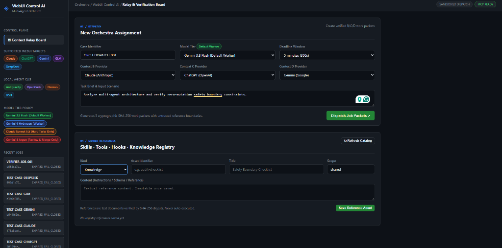

# คู่มือการติดตั้งและใช้งานแบบภาพประกอบ (Visual Step-by-Step Guide) — WebUI Control AI

เอกสารนี้อธิบายขั้นตอนการติดตั้ง การเริ่มต้นใช้งาน และความหมายของทุกส่วนบนหน้าจอ **WebUI Control AI (Multi-Agent Orchestra)** แบบเข้าใจง่ายทีละขั้นตอน พร้อมภาพหน้าจอจริง

---

## สารบัญ

1. [ภาพรวมหน้าจอ Dashboard และความหมายของแต่ละส่วน (Visual Tour)](#1-ภาพรวมหน้าจอ-dashboard-และความหมายของแต่ละส่วน-visual-tour)
2. [ขั้นตอนที่ 1: การติดตั้งกึ่งอัตโนมัติ (Semi-Automated Setup)](#2-ขั้นตอนที่-1-การติดตั้งกึ่งอัตโนมัติ-semi-automated-setup)
3. [ขั้นตอนที่ 2: การเปิดใช้งาน Dashboard (`START_DASHBOARD.cmd`)](#3-ขั้นตอนที่-2-การเปิดใช้งาน-dashboard-start_dashboardcmd)
4. [ขั้นตอนที่ 3: การตรวจสอบและตั้งค่า Working Directory (ป้องกันการทำงานนอกโฟลเดอร์)](#4-ขั้นตอนที่-3-การตรวจสอบและตั้งค่า-working-directory-ป้องกันการทำงานนอกโฟลเดอร์)
5. [ขั้นตอนที่ 4: การสั่งงาน AI หลายตัวพร้อมกัน (Context Relay Board)](#5-ขั้นตอนที่-4-การสั่งงาน-ai-หลายตัวพร้อมกัน-context-relay-board)
6. [ขั้นตอนที่ 5: การเชื่อมต่อ MCP ภายนอก เช่น Lnwjud (`MCP Integrations`)](#6-ขั้นตอนที่-5-การเชื่อมต่อ-mcp-ภายนอก-เช่น-lnwjud-mcp-integrations)
7. [ขั้นตอนที่ 6: การตั้งค่าระบบและสิทธิ์ของโมเดลผ่านหน้าเว็บ (`Settings`)](#7-ขั้นตอนที่-6-การตั้งค่าระบบและสิทธิ์ของโมเดลผ่านหน้าเว็บ-settings)

---

## 1. ภาพรวมหน้าจอ Dashboard และความหมายของแต่ละส่วน (Visual Tour)



> **💡 เคล็ดลับ (Tooltips ภาษาไทยบนหน้าจอจริง):** บนหน้าเว็บ Dashboard คุณสามารถนำเมาส์ไปชี้ (Hover) ที่หัวข้อ ปุ่ม หรือสัญลักษณ์ **`?`** ในจุดใดก็ได้ ระบบจะแสดงคำอธิบายภาษาไทยขึ้นมาทันที

### คำอธิบายส่วนประกอบบนหน้าจอ (ซ้ายไปขวา, บนลงล่าง)

#### แถบเมนูด้านซ้าย (Left Sidebar)
1. **CONTROL PLANE (แผงควบคุมหลัก)**
   - **🗂 Context Relay Board:** หน้ากระดานหลักสำหรับสร้างใบงาน แจกจ่ายงานให้ AI 3 บทบาท (B/C/D) และตรวจรับผลลัพธ์
   - **🔌 MCP Integrations:** หน้าจัดการและเชื่อมต่อ External MCP Servers (เช่น `Lnwjud`)
   - **⚙ Settings:** หน้าตั้งค่าโฟลเดอร์ทำงาน (`Working Directory`), รายการ MCP และสิทธิ์ `Model Policy Overrides`
2. **ACTIVE WORKING DIRECTORY (โฟลเดอร์ทำงานปัจจุบัน)**
   - แสดงเส้นทางโฟลเดอร์ที่อนุญาตให้ AI ทำงานในขณะนั้น เช่น `O:\AI_Workspace\AntiGravity\WebUI_Control_AI`
   - ควบคุมด้วยระบบนิรภัย **`PathGuard`** ป้องกันไม่ให้ AI ออกไปแก้ไขไฟล์นอกโฟลเดอร์ที่กำหนด หรือยุ่งกับโปรเจกต์ต้องห้าม (`REA Project / SummoningRemake`)
   - คลิกที่กล่องนี้เพื่อเปิดแท็บ `Settings` ไปแก้ไขโฟลเดอร์ทำงานได้ทันที
3. **SUPPORTED WEBUI TARGETS (WebUI ที่รองรับ 5 ค่าย)**
   - แสดงสถานะการรองรับ WebUI ทั้ง 5 ผู้ให้บริการ: **`Claude`**, **`ChatGPT`**, **`Gemini`**, **`GLM`** และ **`DeepSeek`**
4. **LOCAL AGENT CLIS (CLI ในเครื่องที่ติดตั้งแล้ว 4 ตัว)**
   - แสดงเครื่องมือ CLI ในเครื่องที่พร้อมรับงาน: **`Antigravity` (`agy`)**, **`OpenCode`**, **`Hermes`** และ **`DSH` (`DeepSeek Harness`)**
5. **MODEL TIER POLICY (นโยบายระดับโมเดล 4 ระดับ)**
   - 🟢 **`Gemini 3.8 Flash [Default Worker]`:** โมเดลมาตรฐานสำหรับงานทั่วไปและงานความเร็วสูง
   - 🔵 **`Gemini 4 Hydrogen [Worker]`:** โมเดลปฏิบัติการทางเลือกสำหรับงานวิเคราะห์และประมวลผลเชิงลึก
   - 🟠 **`Claude Sonnet 5.5 [Hard Tasks Only]`:** โมเดลสำหรับงานยากหรืองานแก้ไขสถาปัตยกรรมซับซ้อนเท่านั้น
   - 🔴 **`Gemini 4 Argon [Review & Merge Only]`:** สงวนสิทธิ์เฉพาะผู้ตรวจงาน (`Reviewer`) และรวมโค้ด (`Merge`) เท่านั้น **ห้ามใช้เป็น Worker ปฏิบัติงานทั่วไป**
6. **RECENT JOBS (รายการงานล่าสุด)**
   - แสดงประวัติใบงานที่เคยสร้าง พร้อมรหัสงานและสถานะ (`AWAITING_WEBUI_PACKET`, `READY_FOR_A_REVIEW`, `EXPIRED_FAIL_CLOSED`) คลิกเพื่อเปิดดูย้อนหลังได้ทันที

#### แถบสถานะด้านบน (Top Bar)
- **Breadcrumbs (`Orchestra / WebUI Control AI / ...`):** แสดงตำแหน่งหน้าจอที่กำลังเปิดใช้งาน
- **`WORKDIR: ...`:** แสดงโฟลเดอร์ทำงานปัจจุบันตลอดเวลาเพื่อให้ตรวจสอบได้ทันทีว่าไม่ได้ทำงานผิดที่
- **`SANDBOXED DISPATCH` & `MCP READY`:** ยืนยันว่าระบบส่งงานอยู่ในโหมด Sandbox นิรภัย และพร้อมเชื่อมต่อกับ MCP

#### พื้นที่ทำงานหลัก (Main Content Area)
- **`01 / DISPATCH — New Orchestra Assignment`:** ฟอร์มสร้างใบงานใหม่ กำหนดรหัสงาน เลือกโมเดล เลือกเวลาหมดอายุ (Deadline) เลือกค่าย AI สำหรับบทบาท B/C/D และพิมพ์โจทย์งาน
- **`02 / ACTIVE RELAY` (แสดงเมื่อสร้างหรือเลือกงาน):** การ์ดงานสำหรับ AI 3 บทบาท (`B = Implementer`, `C = Analyst`, `D = Reviewer`) พร้อมปุ่มคัดลอกคำสั่งในคลิกเดียว (`📋 1-Click Copy Prompt`) และช่องวางคำตอบ JSON
- **`03 / SYNTHESIS & REVIEW`:** ส่วนรวมผลลัพธ์เมื่อทั้ง B, C และ D ส่งคำตอบที่ผ่านการตรวจสอบรหัสแฮช `SHA-256` ครบแล้ว
- **`04 / SHARED REFERENCES — Skills · Tools · Hooks · Knowledge Registry`:** คลังข้อมูลอ้างอิงกลางสำหรับเก็บกฎ เช็กลิสต์ หรือองค์ความรู้ที่ใช้ร่วมกันระหว่าง AI ทุกตัว (เข้ารหัส `SHA-256` กำกับทุกชิ้นและไม่รันโค้ดอัตโนมัติ)

---

## 2. ขั้นตอนที่ 1: การติดตั้งกึ่งอัตโนมัติ (Semi-Automated Setup)

สำหรับผู้เริ่มต้น สามารถติดตั้งและตรวจสอบความพร้อมของระบบทั้งหมดได้ด้วยการรันไฟล์ **`INSTALL_SETUP.cmd`**:

1. เปิดโฟลเดอร์ `O:\AI_Workspace\AntiGravity\WebUI_Control_AI`
2. ดับเบิลคลิกไฟล์ **[INSTALL_SETUP.cmd](../INSTALL_SETUP.cmd)** (หรือรันผ่าน PowerShell):
   ```powershell
   .\INSTALL_SETUP.cmd
   ```
   *(หากต้องการให้รันผ่านทุกขั้นตอนอัตโนมัติโดยไม่ต้องกดยืนยัน ให้ใช้คำสั่ง `.\INSTALL_SETUP.cmd --yes`)*
3. ตัวช่วยติดตั้งจะทำงาน **5 ขั้นตอน** อัตโนมัติ:
   - **Step 1/5 Preflight Doctor:** ตรวจเช็ก Python, Git, CLI ทั้ง 4 ตัว (`Antigravity`, `OpenCode`, `Hermes`, `DSH`) และพอร์ตระบบ
   - **Step 2/5 Init SQLite WAL DB & Runtime Dirs:** สร้างฐานข้อมูล `.runtime/state/orchestra.db` และ `dashboard_settings.db` ในโหมด `WAL`
   - **Step 3/5 Configure 5 WebUI Targets:** ตั้งค่าตัวเชื่อม WebUI ทั้ง 5 ค่าย (`config/browser_targets.json`)
   - **Step 4/5 Generate MCP Configs:** สร้างไฟล์ตั้งค่า MCP ใน `.runtime/mcp_configs/` สำหรับนำไปผูกกับ IDE/CLI
   - **Step 5/5 Self-Test CLIs & DB:** ทดสอบรัน CLI ทั้ง 4 ตัวและทดสอบอ่าน-เขียนฐานข้อมูลจริง

---

## 3. ขั้นตอนที่ 2: การเปิดใช้งาน Dashboard (`START_DASHBOARD.cmd`)

1. ดับเบิลคลิกไฟล์ **[START_DASHBOARD.cmd](../START_DASHBOARD.cmd)** ในโฟลเดอร์โปรเจกต์
2. ระบบจะเปิดเซิร์ฟเวอร์ Dashboard ที่ `http://127.0.0.1:8765` และเปิดเบราว์เซอร์ขึ้นมาให้อัตโนมัติ
3. หากต้องการรันผ่านบรรทัดคำสั่งโดยไม่เปิดเบราว์เซอร์อัตโนมัติ:
   ```powershell
   .\bin\orchestra.cmd dashboard --port 8765
   ```

---

## 4. ขั้นตอนที่ 3: การตรวจสอบและตั้งค่า Working Directory (ป้องกันการทำงานนอกโฟลเดอร์)

ระบบมีกลไก **`PathGuard` (`src/sandbox/workdir_guard.py`)** เพื่อบังคับให้ทุกคำสั่งทำงานเฉพาะในโฟลเดอร์ที่อนุญาตเท่านั้น:

1. สังเกตที่แถบซ้ายมือหัวข้อ **`ACTIVE WORKING DIRECTORY`** และมุมขวาบน **`WORKDIR:`** จะแสดงโฟลเดอร์ปัจจุบันเสมอ
2. หากต้องการเปลี่ยนโฟลเดอร์ทำงานย่อยภายในโปรเจกต์:
   - คลิกที่กล่อง **`ACTIVE WORKING DIRECTORY`** ด้านซ้ายมือ หรือคลิกแท็บ **`⚙ Settings`**
   - ในหัวข้อ **`1. Working Directory`** ให้ระบุโฟลเดอร์ที่ต้องการ (ต้องอยู่ภายใน `O:\AI_Workspace\AntiGravity\WebUI_Control_AI`)
   - กดปุ่ม **`Save Settings ✓`**
3. **ระบบป้องกันอัตโนมัติ:** หากเผลอระบุพาธที่ออกนอกโฟลเดอร์โครงการ (`..`), พาธที่เป็น Junction/Symlink ออกนอกระบบ, โฟลเดอร์กุญแจ `.runtime/keys` หรือโปรเจกต์ต้องห้าม (`O:\AI_Workspace\REA Project\...`) ระบบจะบล็อกด้วยรหัส `403 Forbidden` ทันที

---

## 5. ขั้นตอนที่ 4: การสั่งงาน AI หลายตัวพร้อมกัน (Context Relay Board)

เมื่ออยู่ในหน้า **`🗂 Context Relay Board`**:

1. **กรอกข้อมูลในกรอบ `01 / DISPATCH — New Orchestra Assignment`:**
   - **Case Identifier:** ตั้งชื่อรหัสใบงาน เช่น `ORCH-DISPATCH-001`
   - **Model Tier:** เลือกโมเดลผู้ปฏิบัติงาน (`Gemini 3.8 Flash`, `Gemini 4 Hydrogen`, หรือ `Claude Sonnet 5.5` สำหรับงานยาก)
   - **Deadline Window:** เลือกเวลาหมดอายุของงาน (เช่น `5 minutes (300s)`)
   - **Context B / C / D Provider:** เลือกค่าย WebUI (`Claude`, `ChatGPT`, `Gemini`, `GLM`, `DeepSeek`) ให้แต่ละบทบาท
   - **Task Brief & Input Scenario:** พิมพ์รายละเอียดงานที่ต้องการให้ AI วิเคราะห์หรือดำเนินการ
2. กดปุ่มสีเขียว **`Dispatch Job Packets ↗`**
3. **ส่งงานให้ WebUI และรับคำตอบในกรอบ `02 / ACTIVE RELAY`:**
   - กดปุ่ม **`📋 1-Click Copy Prompt for B`** (และ C, D) เพื่อคัดลอกคำสั่งไปวางในหน้าแชตของ WebUI ที่เลือกไว้
   - เมื่อ AI ตอบกลับมาเป็น JSON ให้คัดลอกมาวางในช่อง **`Paste B's JSON Response`** แล้วกด **`Submit B Response →`**
4. **ตรวจรับผลลัพธ์รวมในกรอบ `03 / SYNTHESIS & REVIEW`:**
   - เมื่อทั้ง B, C และ D ส่งคำตอบครบและผ่านการตรวจลายเซ็น `SHA-256` แล้ว ปุ่ม **`📋 Copy Verified Bundle`** และ **`↓ Export JSON Bundle`** จะเปิดให้กดใช้งานทันที

---

## 6. ขั้นตอนที่ 5: การเชื่อมต่อ MCP ภายนอก เช่น Lnwjud (`MCP Integrations`)

คุณสามารถเพิ่มและทดสอบ External MCP Servers เช่น **[Lnwjud (`https://github.com/engasnm111/lnwjud`)](https://github.com/engasnm111/lnwjud)** ได้โดยตรงผ่านหน้าเว็บ:

1. คลิกที่แท็บ **`🔌 MCP Integrations`** ในแถบด้านซ้าย
2. กดปุ่ม **`⚡ Load Lnwjud Preset`** ที่มุมขวาบนของตาราง ระบบจะกรอกค่ามาตรฐานให้ทันที:
   - **Server Name:** `lnwjud`
   - **Command:** `npx`
   - **Arguments:** `-y @engasnm111/lnwjud`
   - **Status:** `Enabled (Active in Proxy)`
3. กดปุ่ม **`🔍 Probe Command`** เพื่อทดสอบว่าเครื่องของคุณมีคำสั่ง `npx` พร้อมเรียกใช้งานหรือไม่
4. กดปุ่ม **`Save MCP Server`** เพื่อบันทึกลงในไฟล์ `.runtime/mcp_configs/external.json` และฐานข้อมูล SQLite
5. นอกจากนี้ยังสามารถจัดการผ่าน CLI ได้ด้วยคำสั่ง:
   ```powershell
   .\bin\orchestra.cmd mcp-add --preset lnwjud
   .\bin\orchestra.cmd mcp-probe --name lnwjud
   .\bin\orchestra.cmd mcp-list
   ```

---

## 7. ขั้นตอนที่ 6: การตั้งค่าระบบและสิทธิ์ของโมเดลผ่านหน้าเว็บ (`Settings`)

1. คลิกที่แท็บ **`⚙ Settings`** ในแถบด้านซ้าย
2. คุณสามารถจัดการค่าหลักได้ 3 ส่วน:
   - **ส่วนที่ 1 — Working Directory (`working_directory`):** กำหนดโฟลเดอร์ทำงานปัจจุบันภายใต้การป้องกันของ `PathGuard`
   - **ส่วนที่ 2 — External MCP Servers (`external_mcp_servers`):** แก้ไขรายการเซิร์ฟเวอร์ MCP ทั้งหมดในรูปแบบ JSON โดยตรง
   - **ส่วนที่ 3 — Model Policy Overrides (`model_policy_overrides`):**
     - ในโหมดปกติ (`Active Role: operator`) ส่วนนี้จะถูกล็อกไว้ (`LOCKED (REQUIRES REVIEWER ROLE)`) เพื่อป้องกันไม่ให้ Worker แอบเปลี่ยนนโยบายโมเดลเอง
     - หากต้องการปรับเปลี่ยนค่าเริ่มต้นของโมเดล ให้เปลี่ยน `Active Role` ที่มุมขวาบนเป็น **`reviewer (Policy Review & Merge)`** แล้วเลือกโมเดลเริ่มต้น (`gemini-3.8-flash`, `gemini-4-hydrogen`, `claude-sonnet-5.5`) พร้อมระบุหมายเหตุ จากนั้นกด **`Save Settings ✓`**
